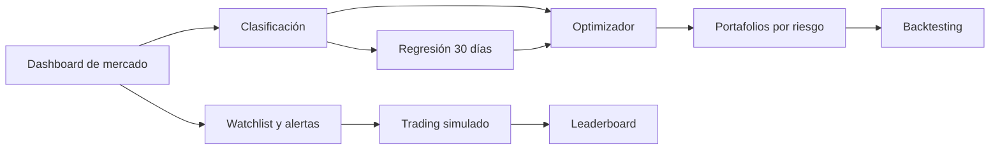
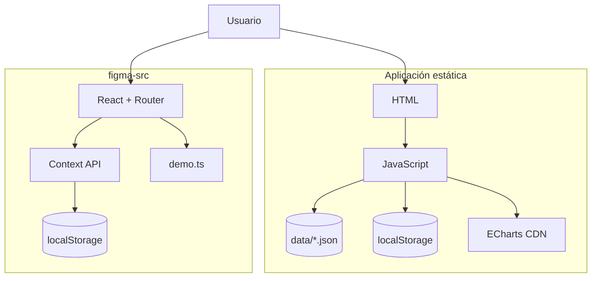

# Ernesto Investing AI

**Plataforma académica de monitoreo bursátil, análisis predictivo y simulación de portafolios**  
**Equipo C · Interacción Humano–Computador 2026-II · FISI-UNMSM**

> [!IMPORTANT]
> Este repositorio tiene fines exclusivamente educativos. El sistema trabaja principalmente con datos sintéticos y resultados simulados. No constituye asesoría financiera, una recomendación de inversión ni una fuente de precios de mercado en tiempo real.

## Descripción

**Ernesto Investing AI** es una aplicación web educativa orientada a explorar de forma integrada conceptos de monitoreo de mercado, clasificación de tendencia, regresión de precios, optimización multiobjetivo de portafolios, perfiles de riesgo, trading simulado y backtesting.

El repositorio contiene una implementación funcional en **HTML, CSS y JavaScript puro** que consume los archivos JSON de la carpeta `data/`, además de una segunda implementación en **React + TypeScript** dentro de `figma-src/`, desarrollada como prototipo de interfaz en Figma Make.

El flujo conceptual del sistema es:



## Estado funcional

La aplicación ubicada en la raíz del repositorio contiene **nueve módulos navegables y funcionales**.

| Módulo | Implementación | Funcionalidad principal | Datos |
|---|---|---|---|
| Dashboard | `index.html` | KPIs de SPY, QQQ y EPU, gráfico de velas y tabla del universo de activos | `03`, `10` |
| Watchlist | `watchlist.html` | Lista personalizada, alertas y evolución reciente | `02`, `10`, `11` |
| Trading | `trading.html` | Compra/venta simulada, efectivo y posiciones persistentes en el navegador | `10`, `11` |
| Leaderboard | `leaderboard.html` | Ranking de traders ficticios y comparación con el portafolio local | `10`, `11`, `12` |
| Clasificación | `clasificacion.html` + `js/clasificacion.js` | 18 clasificadores, probabilidad SUBE/BAJA, consenso y métricas | `05` |
| Regresión 30 días | `regresion.html` + `js/regresion.js` | 18 regresores, proyección de 30 sesiones, ensamble y métricas | `02`, `06` |
| Optimizador | `optimizador.html` + `js/optimizador.js` | Markowitz, NSGA-II, NSGA-III, riesgo-retorno y composición de portafolios | `07` |
| Portafolios | `portafolios.html` + `js/portafolios.js` | Perfiles Conservador, Moderado y Agresivo con pesos y métricas | `08` |
| Backtesting | `backtesting.html` + `js/backtesting.js` | Curvas de capital, drawdown, métricas comparativas y rebalanceos | `09` |

## Arquitectura del repositorio

Actualmente conviven dos implementaciones de frontend con objetivos distintos.

### 1. Aplicación integrada en la raíz

Es la implementación más directamente conectada con los datos del proyecto.

- HTML5, CSS3 y JavaScript sin framework.
- No requiere proceso de compilación.
- Consume los JSON de `data/` mediante `fetch()`.
- Utiliza **ECharts 5.5.1** desde CDN para las visualizaciones que lo requieren.
- Mantiene preferencias y simulaciones locales mediante `localStorage`.
- Está preparada para ejecutarse desde un servidor HTTP estático.

### 2. Prototipo React/Figma Make

La carpeta `figma-src/` contiene una segunda implementación orientada al diseño y evolución de la interfaz.

- React 19.
- React Router 7.
- TypeScript 5.7.
- Vite 8.
- Tailwind CSS 4.
- Lucide React.
- Estado de aplicación centralizado mediante Context API.
- Persistencia local de tema, watchlist, efectivo, posiciones, operaciones, alertas y perfil de riesgo.

Actualmente esta versión utiliza datos de demostración definidos en:

```text
figma-src/src/data/demo.ts
```

Por tanto, **no debe asumirse que la aplicación React consume directamente los archivos JSON de `data/`**.



## Estructura principal

```text
TEAMC_ErnestoInvestingAI/
├── index.html
├── watchlist.html
├── trading.html
├── leaderboard.html
├── clasificacion.html
├── regresion.html
├── optimizador.html
├── portafolios.html
├── backtesting.html
│
├── css/
│   └── styles.css
│
├── js/
│   ├── common.js
│   ├── clasificacion.js
│   ├── regresion.js
│   ├── optimizador.js
│   ├── portafolios.js
│   └── backtesting.js
│
├── data/
│   ├── 01_universo_tickers.json
│   ├── 02_precios_sinteticos_504d.json
│   ├── 03_ohlcv_sintetico_120d.json
│   ├── 04_matriz_correlacion_covarianza.json
│   ├── 05_clasificadores_binarios.json
│   ├── 06_regresores_precio_30d.json
│   ├── 07_optimizador_markowitz_nsga.json
│   ├── 08_portafolios_3_niveles_riesgo.json
│   ├── 09_backtesting_portafolios.json
│   ├── 10_dashboard_mercado.json
│   ├── 11_watchlist_alertas_portafolio_demo.json
│   ├── 12_leaderboard_liga.json
│   └── 13_patrones_y_parametros.json
│
├── figma-src/
│   ├── src/
│   │   ├── app/
│   │   │   ├── App.tsx
│   │   │   └── routes.tsx
│   │   ├── components/
│   │   ├── pages/
│   │   ├── context.tsx
│   │   └── data/
│   │       └── demo.ts
│   ├── package.json
│   ├── pnpm-lock.yaml
│   ├── tsconfig.json
│   └── vite.config.ts
│
├── LICENSE
└── README.md
```

## Tecnologías

| Área | Tecnologías |
|---|---|
| Aplicación principal | HTML5, CSS3, JavaScript ES6+ |
| Visualización | Apache ECharts 5.5.1 |
| Persistencia | Web Storage / `localStorage` |
| Datos | JSON |
| Prototipo UI | React 19, React DOM 19, React Router 7 |
| Estilos del prototipo | Tailwind CSS 4 |
| Lenguaje del prototipo | TypeScript 5.7 |
| Tooling | Vite 8, pnpm, oxfmt |
| Iconografía | Lucide React |

No existe backend, base de datos, autenticación ni API de mercado en este repositorio. El sistema es completamente **client-side**.

## Universo de activos

El conjunto de datos trabaja con **26 activos**.

### Magníficas 7

- AAPL
- MSFT
- GOOGL
- AMZN
- NVDA
- META
- TSLA

### Mineras

- BVN
- FSM
- SCCO
- BHP
- B

### ETF sectoriales

- XLK
- XLF
- XLE
- XLV
- XLY
- XLP
- XLI
- XLU
- XLB
- XLRE
- XLC

### ETF de referencia/globales

- SPY
- QQQ
- EPU

## Catálogo de datos

| Archivo | Contenido |
|---|---|
| `01_universo_tickers.json` | Metadatos del universo, grupos, sectores, precio ancla, volatilidad y beta |
| `02_precios_sinteticos_504d.json` | 504 sesiones de cierres sintéticos para los 26 activos |
| `03_ohlcv_sintetico_120d.json` | Series OHLCV sintéticas de 120 sesiones |
| `04_matriz_correlacion_covarianza.json` | Matrices 26×26 de correlación y covarianza, más retornos esperados |
| `05_clasificadores_binarios.json` | 18 modelos de clasificación: 11 ML + 7 DL |
| `06_regresores_precio_30d.json` | 18 modelos de regresión y 30 sesiones futuras por activo |
| `07_optimizador_markowitz_nsga.json` | Frontera de Markowitz y soluciones NSGA-II/NSGA-III |
| `08_portafolios_3_niveles_riesgo.json` | Portafolios Conservador, Moderado y Agresivo |
| `09_backtesting_portafolios.json` | Backtesting walk-forward y benchmarks SPY, QQQ, EPU y 1/N |
| `10_dashboard_mercado.json` | Resumen de mercado para el Dashboard |
| `11_watchlist_alertas_portafolio_demo.json` | Estado inicial de watchlist, alertas y portafolio demo |
| `12_leaderboard_liga.json` | Ranking sintético de la liga |
| `13_patrones_y_parametros.json` | Semilla, parámetros, trazabilidad y distinción entre datos reales y sintéticos |

### Naturaleza de los datos

Según `data/13_patrones_y_parametros.json`:

- la semilla de generación es **2026**;
- la fecha de anclaje de precios es **11 de noviembre de 2026**;
- la generación del conjunto se registró el **13 de noviembre de 2026**;
- se utilizan como referencia el último precio de cada ticker y estimaciones de volatilidad, beta y correlación;
- la historia de 504 sesiones, OHLCV, clasificaciones, regresiones, soluciones de optimización, portafolios y backtesting son sintéticos.

Los modelos de ML/DL **no se entrenan dentro de este repositorio**. Sus probabilidades, predicciones y métricas forman parte del conjunto de datos simulado.

## Ejecución de la aplicación principal

### Requisitos

Solo se necesita:

- un navegador web moderno;
- un servidor HTTP local.

Python 3 es suficiente para levantar uno rápidamente.

### Instalación

```bash
git clone https://github.com/SoftJonatanDev/TEAMC_ErnestoInvestingAI.git
cd TEAMC_ErnestoInvestingAI
python -m http.server 8000
```

Luego abrir:

```text
http://127.0.0.1:8000
```

> [!NOTE]
> No se recomienda abrir `index.html` directamente mediante `file://`, porque el navegador puede bloquear las solicitudes `fetch()` realizadas hacia los archivos JSON.

Las visualizaciones basadas en ECharts requieren conexión a Internet para descargar la librería desde CDN.

## Ejecución del prototipo React/Figma

La configuración incluida en `figma-src/.mise.toml` define:

- Node.js 22.
- pnpm 10.34.3.

```bash
cd figma-src
pnpm install
pnpm dev
```

La configuración de Vite utiliza el puerto **8443** por defecto, salvo que la variable de entorno `PORT` indique otro valor.

```text
http://localhost:8443
```

### Comandos disponibles

```bash
pnpm dev
pnpm build
pnpm preview
pnpm format
```

## Rutas del prototipo React

| Ruta | Módulo |
|---|---|
| `/` | Dashboard |
| `/watchlist` | Watchlist |
| `/trading` | Trading |
| `/leaderboard` | Leaderboard |
| `/clasificacion` | Clasificación |
| `/regresion` | Regresión |
| `/optimizador` | Optimizador |
| `/portafolios` | Portafolios |
| `/backtesting` | Backtesting |

## Estado y persistencia local

### Aplicación principal

Se utilizan, entre otras, las siguientes claves de `localStorage`:

- `eia_theme`: tema visual.
- `eia_watch`: watchlist del usuario.
- `eia_port`: efectivo y posiciones del trading simulado.

### Prototipo React

El Context API persiste localmente:

- tema;
- activo seleccionado;
- watchlist;
- efectivo;
- posiciones;
- historial de operaciones;
- alertas;
- perfil de riesgo seleccionado.

La información queda únicamente en el navegador del usuario y **no se sincroniza con ningún servidor**.

## Consideraciones de IHC y accesibilidad

El proyecto incorpora decisiones alineadas con el contexto académico de **Interacción Humano–Computador**:

- idioma principal declarado como español;
- navegación consistente entre módulos;
- tema claro y oscuro;
- diseño adaptable;
- enlace para saltar directamente al contenido principal;
- estados de foco visibles;
- etiquetas asociadas a controles;
- uso de encabezados, tablas y atributos ARIA;
- mensajes de error y estado accesibles;
- bypass links habilitados en la configuración de Figma Make.

## Clasificación de tendencia

El módulo de clasificación utiliza el archivo:

```text
data/05_clasificadores_binarios.json
```

El conjunto contempla **18 clasificadores**:

- 11 modelos de Machine Learning.
- 7 modelos de Deep Learning.

La interfaz permite analizar:

- probabilidades de subida y bajada;
- consenso entre modelos;
- resultados por activo;
- métricas específicas;
- matrices de confusión;
- diferencias entre familias ML y DL.

Las predicciones son simuladas y tienen fines educativos.

## Regresión de precios

El módulo de regresión combina:

```text
data/02_precios_sinteticos_504d.json
data/06_regresores_precio_30d.json
```

Se consideran **18 regresores** y un horizonte de **30 sesiones futuras**.

La interfaz permite visualizar:

- historia reciente del activo;
- trayectorias proyectadas por modelo;
- modelos ML y DL;
- ensamble;
- métricas MAE y RMSE;
- retorno proyectado.

## Optimización de portafolios

El optimizador trabaja con:

```text
data/07_optimizador_markowitz_nsga.json
```

El dataset incluye:

- 12 activos considerados elegibles;
- 35 soluciones de Markowitz sobre el universo completo;
- 35 soluciones de Markowitz sobre activos elegibles;
- 40 soluciones NSGA-II;
- 60 soluciones NSGA-III.

Los métodos representados son:

### Markowitz

Optimización clásica basada en la relación entre retorno esperado y volatilidad.

### NSGA-II

Algoritmo evolutivo multiobjetivo utilizado para explorar soluciones de compromiso entre diferentes métricas.

### NSGA-III

Extensión orientada a problemas con múltiples objetivos, representada en el sistema junto con métricas de riesgo como CVaR.

Las soluciones incluidas en el repositorio son **simuladas**.

## Portafolios por nivel de riesgo

El archivo:

```text
data/08_portafolios_3_niveles_riesgo.json
```

define tres perfiles:

### Conservador

Priorización de menor volatilidad y mayor estabilidad.

### Moderado

Equilibrio entre retorno esperado y exposición al riesgo.

### Agresivo

Mayor búsqueda de retorno esperado aceptando una volatilidad superior.

Cada perfil incluye composición, ponderaciones y métricas asociadas.

## Backtesting

El módulo de Backtesting utiliza:

```text
data/09_backtesting_portafolios.json
```

El conjunto contiene **253 puntos de serie para un periodo de 252 sesiones**, junto con los perfiles:

- Conservador;
- Moderado;
- Agresivo.

Los resultados se comparan contra:

- SPY;
- QQQ;
- EPU;
- portafolio equiponderado `1/N`.

La interfaz presenta:

- evolución del capital;
- drawdown;
- métricas de desempeño;
- volatilidad;
- Sharpe;
- CAGR;
- rebalanceos;
- pesos históricos.

## Flujo de análisis financiero simulado

El diseño de los módulos permite seguir un proceso académico de extremo a extremo:

1. Explorar el universo de activos desde el Dashboard.
2. Crear una Watchlist y configurar alertas.
3. Simular compras y ventas.
4. Analizar el consenso de 18 clasificadores.
5. Comparar proyecciones de 18 regresores a 30 sesiones.
6. Explorar soluciones de Markowitz, NSGA-II y NSGA-III.
7. Seleccionar uno de tres perfiles de portafolio.
8. Evaluar los portafolios mediante backtesting y benchmarks.
9. Comparar el desempeño simulado en el Leaderboard.

## Limitaciones conocidas

Este repositorio representa un **prototipo académico** y no una plataforma financiera de producción.

- No consume precios de mercado en tiempo real.
- No ejecuta entrenamiento ni inferencia real de modelos.
- No posee backend ni base de datos.
- No implementa autenticación o cuentas de usuario.
- La persistencia se limita al navegador.
- La aplicación estática depende de un CDN para ECharts.
- `figma-src/` todavía utiliza datos demo embebidos en lugar de consumir directamente `data/`.
- Actualmente no se incluye una suite de pruebas automatizadas.
- Actualmente no se incluye un pipeline de integración continua.

## Desarrollo

Para mantener la coherencia del proyecto se recomienda:

1. Tratar `data/` como la fuente de datos de la aplicación estática.
2. Mantener visible la advertencia de datos sintéticos en cualquier nueva pantalla.
3. Evitar presentar predicciones o métricas simuladas como resultados de mercado reales.
4. Conservar compatibilidad con tema claro/oscuro.
5. Mantener navegación mediante teclado y estados de foco visibles.
6. Separar lógica, presentación y acceso a datos cuando se añadan nuevas funcionalidades.
7. Si se evoluciona `figma-src/`, priorizar una capa de adaptación que reutilice los JSON de `data/` en lugar de duplicar valores de demostración.
8. Ejecutar `pnpm format` antes de integrar cambios en la aplicación React.

## Próximos pasos técnicos

Algunas mejoras naturales para evolucionar el proyecto serían:

- unificar la aplicación estática y el prototipo React;
- crear una capa común de acceso a datos;
- reemplazar los datos demo de `figma-src/` por los JSON del repositorio;
- incorporar pruebas unitarias y de interfaz;
- añadir validación automática de los datasets;
- configurar CI con GitHub Actions;
- añadir linting y controles de calidad;
- documentar contratos de los archivos JSON;
- incorporar pruebas de accesibilidad automatizadas;
- desacoplar las visualizaciones de la lógica de negocio.

## Licencia y atribución

Material educativo de **Ernesto D. Cancho-Rodríguez — FISI-UNMSM**.

El código, los datos sintéticos y los textos se distribuyen bajo **Creative Commons Attribution 4.0 International (CC BY 4.0)**.

Consultar [`LICENSE`](LICENSE) para los términos completos.

Parte del código del proyecto fue elaborada con asistencia de herramientas de IA generativa y posteriormente revisada por sus autores.

---

**Ernesto Investing AI · Equipo C · IHC 2026-II**

Proyecto académico para la exploración de interfaces financieras, análisis predictivo y simulación de decisiones de inversión.
